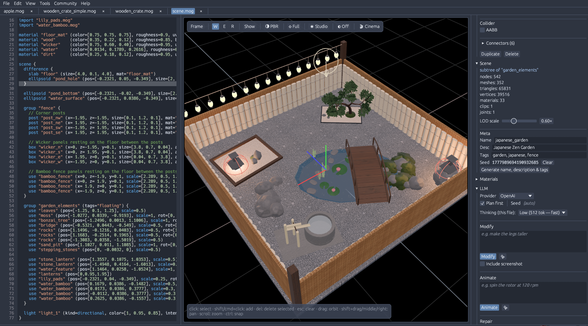

# MoGen — procedural 3D model generator



`mogen` turns a compact, declarative DSL into `.glb` assets. It is designed to be the
deterministic backend of an LLM-driven 3D generation pipeline: the language model writes
high-level structured scenes, `mogen` expands them into real geometry.

Written in Rust. No runtime, no graph editor, no dependencies on a game engine — just a
small parser, a scene graph, a mesh library, and a glTF exporter.

<video src="https://github.com/krazyjakee/MoGen/raw/refs/heads/master/assets/demo.mp4" controls></video>

## Why

LLMs are good at structure and intent, bad at floating-point geometry. The DSL lets the
model decide *what* to build — parts, roles, relationships — while deterministic Rust
code decides *how*. Small outputs, cheap iteration, no hallucinated triangles.

## Features

Primitives, CSG, hierarchy and modules, arrays and mirrors, connectors, skeletons +
skinning + animation, PBR materials with embedded textures, procedural generators
(plants, buildings, caves, terrain, dungeons), validation diagnostics, GLB and FBX
export, and LLM-driven generate / modify / animate / repair / textures. See
[`docs/dsl.md`](docs/dsl.md) for the language.

## Install

### Prebuilt binaries (recommended)

Linux and macOS — one-liner installer:

```sh
curl -fsSL https://raw.githubusercontent.com/krazyjakee/MoGen/master/scripts/install.sh | bash
```

This pulls the latest release from
[GitHub Releases](https://github.com/krazyjakee/MoGen/releases), verifies the SHA-256
checksum, and installs `mogen` and `mogen-studio` into `$HOME/.local/bin`. Run with
`-s -- --help` for options (`--version`, `--bin-dir`, `--cli-only`, `--studio-only`,
`--force`).

Windows — grab the `mogen-<version>-x86_64-pc-windows-msvc.zip` archive from the
releases page and extract it somewhere on your `PATH`.

### Build from source

Requires a recent stable Rust toolchain.

```sh
git clone https://github.com/krazyjakee/MoGen.git
cd MoGen
./scripts/build-release.sh # cargo build --release --workspace
```

The release binary is at `target/release/mogen`. The `./scripts/run-mogen.sh` wrapper runs it via
`cargo run --release` if you'd rather not add it to `$PATH`.

## Quick start

```sh
./scripts/run-mogen.sh build examples/furniture/chair.mog --out chair.glb
```

Drop `chair.glb` into Godot, Blender, three.js, or anything else that reads glTF 2.0.

For generation with visual review, scoped corrections and durable resume, see
[`mogen session`](docs/cli.md#session) and Studio's
[Generate and Refine](docs/studio.md#generate-and-refine).

## Importing Pascal buildings

[pascalorg/editor](https://github.com/pascalorg/editor) is a free web-based architectural
editor. MoGen converts its `.json` scenes into editable `.mog` source (not a GLB); anything
it could not use is listed in the file's header comment. Studio has the same flow under
**File → Import Pascal Scene…**. Details: [`docs/cli.md#import`](docs/cli.md#import).

```sh
./scripts/run-mogen.sh import scene.json --out house.mog
./scripts/run-mogen.sh build house.mog --out house.glb
```

New to the Pascal editor? This short video walks through drawing a building in it:

[](https://youtube.com/shorts/99ckljvqyL4)

## Web preview

The browser preview (`crates/mogen-wasm` + `web/`) runs the same parse → lower
→ export pipeline the desktop CLI uses, and renders the resulting GLB with
three.js. CSG (`union`/`difference`/`intersect`) and sibling-mesh merge work
on the wasm build via [`manifold-csg`'s `unstable-wasm-uu` feature][m-csg-wasm],
which cross-compiles the same Manifold C++ kernel used on desktop through
[`wasm-cxx-shim`][shim].

Building the wasm crate needs LLVM 20+ on the host:

- macOS: `brew install llvm` (then prepend `$(brew --prefix llvm)/bin` to PATH)
- Debian/Ubuntu: `apt install clang-20 lld-20 libc++-20-dev libc++abi-20-dev`
  (often via [apt.llvm.org][apt-llvm] on older distros)
- Other prefixes: set `WASM_CXX_SHIM_LLVM_BIN_DIR=/path/to/llvm/bin`

```sh
rustup target add wasm32-unknown-unknown
cargo install wasm-pack    # if you don't have it yet
wasm-pack build crates/mogen-wasm --target web \
  --out-dir ../../web/wasm --out-name mogen_wasm --release
(cd web && npm install && npm run dev)
```

The first wasm-pack invocation clones Manifold + Clipper2 + wasm-cxx-shim
and runs three cmake cross-compiles; subsequent builds use the cached
artifacts.

Currently disabled in the browser: texture packing (no fs / no oxipng cross-
compile), the LLM `generate`/`modify`/`animate` flows (server-only), and
top-level `use "file.mog"` imports (no fs). The `unstable-wasm-uu` build is
compiled `-fno-exceptions`, so an STL throw (e.g. `bad_alloc` on extreme
inputs) becomes an unrecoverable wasm trap — the preview tab can recover by
reloading.

[m-csg-wasm]: https://github.com/zmerlynn/manifold-csg#browser-without-emscripten-wasm32-unknown-unknown
[shim]: https://github.com/zmerlynn/wasm-cxx-shim
[apt-llvm]: https://apt.llvm.org/

## MoGen Studio

The desktop GUI: DSL editor, live 3D preview with gizmos, inspector, diagnostics, and the
AI tools. Run it from a checkout with:

```sh
./scripts/run-studio.sh
```

See [`docs/studio.md`](docs/studio.md). The same docs are built into Studio's Help menu.

## The DSL

Files use the `.mog` extension. Every statement is a `kind`, an optional name,
attributes, and optional children:

```
kind "optional name" (attr=value, attr=value, ...) {
  // optional children
}
```

```mogen
scene {
  box "seat" (pos=[0, 0.5, 0], size=[1.0, 0.1, 1.0])
  box "back" (pos=[0, 1.0, -0.45], size=[1.0, 1.0, 0.1])
}
```

Coordinates are glTF-standard: right-handed, +Y up, -Z forward. Full reference:
[`docs/dsl.md`](docs/dsl.md), stdlib modules: [`docs/modules.md`](docs/modules.md),
examples: [`examples/`](examples/).

## CLI

```
mogen build      <file.mog> --out <file.glb|fbx>   # compile DSL
mogen check      <file.mog> [--json]               # validate
mogen import     <scene.json> --out <file.mog>     # pascalorg/editor scene → DSL source
mogen generate   "a wooden stool" --out out.glb    # LLM-generate, then compile
mogen modify     <file.mog> "make the legs taller" # LLM edit
mogen animate    <file.mog> "spin the rotor"       # LLM edit limited to animations
mogen repair     <file.mog>                        # LLM fix for validation errors
mogen textures   <file.mog>                        # generate albedo + derived PBR maps
mogen thumbnail  <file.mog> --out preview.png      # headless PNG render
mogen pack|unpack                                  # experimental MOGB binary container
mogen inspect    <file.glb>                        # summarize a GLB
mogen moghub     discover --query chair            # MoGHub community
mogen mcp                                          # stdio MCP server
mogen auth       status                            # OAuth / MoGHub sign-in
mogen update                                       # self-update
```

Every subcommand and flag is documented in [`docs/cli.md`](docs/cli.md).

### AI providers

The LLM commands default to OpenAI GPT-6 Astra (`OPENAI_API_KEY`). Select another backend
with `--provider`: Gemini (API key or Google OAuth), Anthropic, Ollama, OpenAI Codex or
Claude Code subscriptions, Fireworks AI, or Z.ai. Keys can come from `--api-key`, the
provider's env var, or `~/.mogen/settings.json` (shared with Studio).

For Gemini with a paid Google account, `mogen auth gemini-cli login` signs in without an
API key (and `mogen auth antigravity login` enables OAuth texture generation). If Google
sign-in fails, set `GEMINI_API_KEY` as a fallback.

Provider table, credential precedence, and auth details:
[`docs/cli.md#providers-and-credentials`](docs/cli.md#providers-and-credentials).

## Contributing

Issues and PRs welcome. Good first targets:

- more primitives or parameterized modules in `mogen-geom`
- validation passes in `mogen-dsl/src/lower.rs` (unknown attrs, out-of-range values)
- a second exporter alongside GLB
- snapshot/round-trip tests for the example scenes

Run the test suite with `./scripts/run-tests.sh`.

## 💖 Support Me
Hi! I’m krazyjakee 🎮, creator and maintain­er of the *NodotProject* - a suite of open‑source Godot tools (e.g. Nodot, Gedis, GedisQueue etc) that empower game developers to build faster and maintain cleaner code.

I’m looking for sponsors to help sustain and grow the project: more dev time, better docs, more features, and deeper community support. Your support means more stable, polished tools used by indie makers and studios alike.

[](https://ko-fi.com/krazyjakee)

Every contribution helps maintain and improve this project. And encourage me to make more projects like this!

*This is optional support. The tool remains free and open-source regardless.*

## License

MIT — see [LICENSE](LICENSE).
